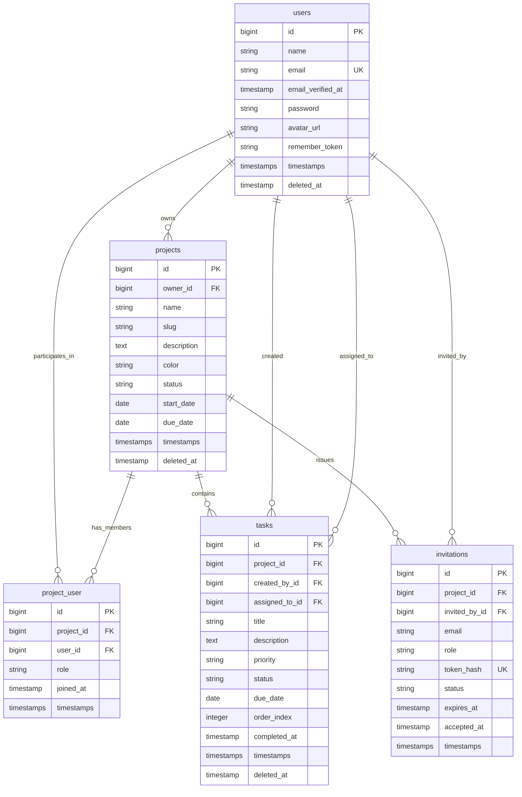

# Database Schema & Eloquent ORM Architecture

## Project: CollabTask - Multi-Project & Team Task Management System
- **Database Engine:** MySQL 8.0+ / MariaDB 10.11+
- **Default Collation:** `utf8mb4_unicode_ci`
- **Storage Engine:** InnoDB (Strict Mode, Foreign Key Checks Active)
- **Document Version:** 1.0.0

---

## 1. Entity Relationship Overview

The core domain model revolves around 5 fundamental tables:
1. `users`: System users capable of owning and participating across multiple projects.
2. `projects`: High-level isolated project containers.
3. `project_user`: Pivot table mapping users to projects with designated roles (`owner`, `admin`, `member`, `viewer`).
4. `tasks`: Action items strictly scoped to a single project, assigned to project members.
5. `invitations`: Cryptographically secured project invitations dispatched to collaborator emails.

### Mermaid Entity-Relationship Diagram



---

## 2. Complete Database Table Schemas

### 2.1 Table: `users`
Stores user authentication identities, personal metadata, and profile settings.

| Column | Data Type | Nullable | Default | Description & Key |
|---|---|:---:|---|---|
| `id` | `BIGINT UNSIGNED` | ❌ | `AUTO_INCREMENT` | Primary Key |
| `name` | `VARCHAR(255)` | ❌ | — | Full display name |
| `email` | `VARCHAR(255)` | ❌ | — | Unique user email address (`UNIQUE INDEX`) |
| `email_verified_at` | `TIMESTAMP` | ✅ | `NULL` | Verification timestamp |
| `password` | `VARCHAR(255)` | ❌ | — | Bcrypt / Argon2id password hash |
| `avatar_url` | `VARCHAR(512)` | ✅ | `NULL` | Hosted avatar URL or path |
| `remember_token` | `VARCHAR(100)` | ✅ | `NULL` | Remember me cookie authentication token |
| `created_at` | `TIMESTAMP` | ✅ | `NULL` | Record creation timestamp |
| `updated_at` | `TIMESTAMP` | ✅ | `NULL` | Last modification timestamp |
| `deleted_at` | `TIMESTAMP` | ✅ | `NULL` | Soft delete timestamp |

**Indexes & Constraints:**
- `PRIMARY KEY (id)`
- `UNIQUE INDEX users_email_unique (email)`

---

### 2.2 Table: `projects`
Represents an isolated project workspace workspace container owned by a user.

| Column | Data Type | Nullable | Default | Description & Key |
|---|---|:---:|---|---|
| `id` | `BIGINT UNSIGNED` | ❌ | `AUTO_INCREMENT` | Primary Key |
| `owner_id` | `BIGINT UNSIGNED` | ❌ | — | Foreign Key referencing `users(id)` |
| `name` | `VARCHAR(255)` | ❌ | — | Human-readable project name |
| `slug` | `VARCHAR(255)` | ❌ | — | URL-safe slug unique per owner |
| `description` | `TEXT` | ✅ | `NULL` | Extended markdown description / brief |
| `color` | `VARCHAR(7)` | ❌ | `#4F46E5` | Hex color code for UI badges and dots |
| `status` | `VARCHAR(50)` | ❌ | `active` | Project state (`active`, `on_hold`, `archived`, `completed`) |
| `start_date` | `DATE` | ✅ | `NULL` | Project commencement date |
| `due_date` | `DATE` | ✅ | `NULL` | Target delivery deadline |
| `created_at` | `TIMESTAMP` | ✅ | `NULL` | Record creation timestamp |
| `updated_at` | `TIMESTAMP` | ✅ | `NULL` | Last modification timestamp |
| `deleted_at` | `TIMESTAMP` | ✅ | `NULL` | Soft delete timestamp |

**Indexes & Constraints:**
- `PRIMARY KEY (id)`
- `FOREIGN KEY (owner_id) REFERENCES users(id) ON DELETE CASCADE`
- `UNIQUE INDEX projects_owner_slug_unique (owner_id, slug)`
- `INDEX projects_status_index (status)`

---

### 2.3 Table: `project_user` (Pivot)
Manages multi-tenant project membership and role assignments.

| Column | Data Type | Nullable | Default | Description & Key |
|---|---|:---:|---|---|
| `id` | `BIGINT UNSIGNED` | ❌ | `AUTO_INCREMENT` | Primary Key |
| `project_id` | `BIGINT UNSIGNED` | ❌ | — | Foreign Key referencing `projects(id)` |
| `user_id` | `BIGINT UNSIGNED` | ❌ | — | Foreign Key referencing `users(id)` |
| `role` | `VARCHAR(30)` | ❌ | `member` | Role enum (`owner`, `admin`, `member`, `viewer`) |
| `joined_at` | `TIMESTAMP` | ❌ | `CURRENT_TIMESTAMP`| Timestamp when membership was accepted |
| `created_at` | `TIMESTAMP` | ✅ | `NULL` | Record creation timestamp |
| `updated_at` | `TIMESTAMP` | ✅ | `NULL` | Last modification timestamp |

**Indexes & Constraints:**
- `PRIMARY KEY (id)`
- `FOREIGN KEY (project_id) REFERENCES projects(id) ON DELETE CASCADE`
- `FOREIGN KEY (user_id) REFERENCES users(id) ON DELETE CASCADE`
- `UNIQUE INDEX project_user_unique (project_id, user_id)`
- `INDEX project_user_role_index (role)`

---

### 2.4 Table: `tasks`
Work items strictly isolated within a specific project.

| Column | Data Type | Nullable | Default | Description & Key |
|---|---|:---:|---|---|
| `id` | `BIGINT UNSIGNED` | ❌ | `AUTO_INCREMENT` | Primary Key |
| `project_id` | `BIGINT UNSIGNED` | ❌ | — | Foreign Key referencing `projects(id)` |
| `created_by_id`| `BIGINT UNSIGNED` | ❌ | — | Foreign Key referencing `users(id)` |
| `assigned_to_id`| `BIGINT UNSIGNED`| ✅ | `NULL` | Foreign Key referencing `users(id)` |
| `title` | `VARCHAR(255)` | ❌ | — | Task title / summary |
| `description` | `LONGTEXT` | ✅ | `NULL` | Detailed markdown task body |
| `priority` | `VARCHAR(20)` | ❌ | `medium` | Enum: `low`, `medium`, `high`, `urgent` |
| `status` | `VARCHAR(30)` | ❌ | `todo` | Enum: `todo`, `in_progress`, `in_review`, `completed` |
| `due_date` | `DATE` | ✅ | `NULL` | Due date deadline |
| `order_index` | `INT UNSIGNED` | ❌ | `1000` | Sorting position inside column track |
| `completed_at` | `TIMESTAMP` | ✅ | `NULL` | Timestamp captured when moved to `completed` |
| `created_at` | `TIMESTAMP` | ✅ | `NULL` | Record creation timestamp |
| `updated_at` | `TIMESTAMP` | ✅ | `NULL` | Last modification timestamp |
| `deleted_at` | `TIMESTAMP` | ✅ | `NULL` | Soft delete timestamp |

**Indexes & Constraints:**
- `PRIMARY KEY (id)`
- `FOREIGN KEY (project_id) REFERENCES projects(id) ON DELETE CASCADE`
- `FOREIGN KEY (created_by_id) REFERENCES users(id) ON DELETE CASCADE`
- `FOREIGN KEY (assigned_to_id) REFERENCES users(id) ON DELETE SET NULL`
- `INDEX tasks_project_status_order_idx (project_id, status, order_index)`
- `INDEX tasks_project_assigned_idx (project_id, assigned_to_id)`
- `INDEX tasks_project_priority_idx (project_id, priority)`
- `INDEX tasks_due_date_idx (due_date)`

---

### 2.5 Table: `invitations`
Stores pending, accepted, or expired email invitations for team onboarding.

| Column | Data Type | Nullable | Default | Description & Key |
|---|---|:---:|---|---|
| `id` | `BIGINT UNSIGNED` | ❌ | `AUTO_INCREMENT` | Primary Key |
| `project_id` | `BIGINT UNSIGNED` | ❌ | — | Foreign Key referencing `projects(id)` |
| `invited_by_id`| `BIGINT UNSIGNED` | ❌ | — | Foreign Key referencing `users(id)` |
| `email` | `VARCHAR(255)` | ❌ | — | Recipient email address |
| `role` | `VARCHAR(30)` | ❌ | `member` | Role granted upon acceptance |
| `token_hash` | `CHAR(64)` | ❌ | — | Cryptographic SHA-256 hash of token |
| `status` | `VARCHAR(30)` | ❌ | `pending` | Enum: `pending`, `accepted`, `rejected`, `expired` |
| `expires_at` | `TIMESTAMP` | ❌ | — | Expiration threshold (default 7 days) |
| `accepted_at` | `TIMESTAMP` | ✅ | `NULL` | Timestamp when invite was claimed |
| `created_at` | `TIMESTAMP` | ✅ | `NULL` | Record creation timestamp |
| `updated_at` | `TIMESTAMP` | ✅ | `NULL` | Last modification timestamp |

**Indexes & Constraints:**
- `PRIMARY KEY (id)`
- `FOREIGN KEY (project_id) REFERENCES projects(id) ON DELETE CASCADE`
- `FOREIGN KEY (invited_by_id) REFERENCES users(id) ON DELETE CASCADE`
- `UNIQUE INDEX invitations_token_hash_unique (token_hash)`
- `INDEX invitations_project_email_idx (project_id, email)`
- `INDEX invitations_status_expires_idx (status, expires_at)`

---

## 3. Production Migration Definitions

### Migration: `2026_01_01_000001_create_projects_table.php`
```php
use Illuminate\Database\Migrations\Migration;
use Illuminate\Database\Schema\Blueprint;
use Illuminate\Support\Facades\Schema;

return new class extends Migration {
    public function up(): void
    {
        Schema::create('projects', function (Blueprint $table) {
            $table->id();
            $table->foreignId('owner_id')->constrained('users')->cascadeOnDelete();
            $table->string('name');
            $table->string('slug');
            $table->text('description')->nullable();
            $table->string('color', 7)->default('#4F46E5');
            $table->string('status', 50)->default('active')->index();
            $table->date('start_date')->nullable();
            $table->date('due_date')->nullable();
            $table->timestamps();
            $table->softDeletes();

            $table->unique(['owner_id', 'slug']);
        });
    }

    public function down(): void
    {
        Schema::dropIfExists('projects');
    }
};
```

### Migration: `2026_01_01_000002_create_project_user_table.php`
```php
use Illuminate\Database\Migrations\Migration;
use Illuminate\Database\Schema\Blueprint;
use Illuminate\Support\Facades\Schema;

return new class extends Migration {
    public function up(): void
    {
        Schema::create('project_user', function (Blueprint $table) {
            $table->id();
            $table->foreignId('project_id')->constrained('projects')->cascadeOnDelete();
            $table->foreignId('user_id')->constrained('users')->cascadeOnDelete();
            $table->string('role', 30)->default('member')->index();
            $table->timestamp('joined_at')->useCurrent();
            $table->timestamps();

            $table->unique(['project_id', 'user_id']);
        });
    }

    public function down(): void
    {
        Schema::dropIfExists('project_user');
    }
};
```

### Migration: `2026_01_01_000003_create_tasks_table.php`
```php
use Illuminate\Database\Migrations\Migration;
use Illuminate\Database\Schema\Blueprint;
use Illuminate\Support\Facades\Schema;

return new class extends Migration {
    public function up(): void
    {
        Schema::create('tasks', function (Blueprint $table) {
            $table->id();
            $table->foreignId('project_id')->constrained('projects')->cascadeOnDelete();
            $table->foreignId('created_by_id')->constrained('users')->cascadeOnDelete();
            $table->foreignId('assigned_to_id')->nullable()->constrained('users')->nullOnDelete();
            $table->string('title');
            $table->longText('description')->nullable();
            $table->string('priority', 20)->default('medium');
            $table->string('status', 30)->default('todo');
            $table->date('due_date')->nullable()->index();
            $table->unsignedInteger('order_index')->default(1000);
            $table->timestamp('completed_at')->nullable();
            $table->timestamps();
            $table->softDeletes();

            $table->index(['project_id', 'status', 'order_index']);
            $table->index(['project_id', 'assigned_to_id']);
            $table->index(['project_id', 'priority']);
        });
    }

    public function down(): void
    {
        Schema::dropIfExists('tasks');
    }
};
```

### Migration: `2026_01_01_000004_create_invitations_table.php`
```php
use Illuminate\Database\Migrations\Migration;
use Illuminate\Database\Schema\Blueprint;
use Illuminate\Support\Facades\Schema;

return new class extends Migration {
    public function up(): void
    {
        Schema::create('invitations', function (Blueprint $table) {
            $table->id();
            $table->foreignId('project_id')->constrained('projects')->cascadeOnDelete();
            $table->foreignId('invited_by_id')->constrained('users')->cascadeOnDelete();
            $table->string('email');
            $table->string('role', 30)->default('member');
            $table->char('token_hash', 64)->unique();
            $table->string('status', 30)->default('pending');
            $table->timestamp('expires_at');
            $table->timestamp('accepted_at')->nullable();
            $table->timestamps();

            $table->index(['project_id', 'email']);
            $table->index(['status', 'expires_at']);
        });
    }

    public function down(): void
    {
        Schema::dropIfExists('invitations');
    }
};
```

---

## 4. Eloquent Models & Relationship Implementations

### 4.1 Model: `User.php`
```php
namespace App\Models;

use Illuminate\Database\Eloquent\Factories\HasFactory;
use Illuminate\Database\Eloquent\Relations\BelongsToMany;
use Illuminate\Database\Eloquent\Relations\HasMany;
use Illuminate\Database\Eloquent\SoftDeletes;
use Illuminate\Foundation\Auth\User as Authenticatable;
use Illuminate\Notifications\Notifiable;

class User extends Authenticatable
{
    use HasFactory, Notifiable, SoftDeletes;

    protected $fillable = [
        'name',
        'email',
        'password',
        'avatar_url',
    ];

    protected $hidden = [
        'password',
        'remember_token',
    ];

    protected function casts(): array
    {
        return [
            'email_verified_at' => 'datetime',
            'password' => 'hashed',
        ];
    }

    /**
     * Projects directly owned by this user.
     */
    public function ownedProjects(): HasMany
    {
        return $this->hasMany(Project::class, 'owner_id');
    }

    /**
     * All projects the user belongs to (as owner, admin, member, or viewer).
     */
    public function projects(): BelongsToMany
    {
        return $this->belongsToMany(Project::class, 'project_user')
            ->using(ProjectUser::class)
            ->withPivot(['role', 'joined_at'])
            ->withTimestamps();
    }

    /**
     * Tasks assigned to this user across all projects.
     */
    public function assignedTasks(): HasMany
    {
        return $this->hasMany(Task::class, 'assigned_to_id');
    }

    /**
     * Tasks created by this user.
     */
    public function createdTasks(): HasMany
    {
        return $this->hasMany(Task::class, 'created_by_id');
    }

    /**
     * Invitations sent by this user.
     */
    public function sentInvitations(): HasMany
    {
        return $this->hasMany(Invitation::class, 'invited_by_id');
    }
}
```

---

### 4.2 Model: `Project.php`
```php
namespace App\Models;

use Illuminate\Database\Eloquent\Factories\HasFactory;
use Illuminate\Database\Eloquent\Model;
use Illuminate\Database\Eloquent\Relations\BelongsTo;
use Illuminate\Database\Eloquent\Relations\BelongsToMany;
use Illuminate\Database\Eloquent\Relations\HasMany;
use Illuminate\Database\Eloquent\SoftDeletes;

class Project extends Model
{
    use HasFactory, SoftDeletes;

    protected $fillable = [
        'owner_id',
        'name',
        'slug',
        'description',
        'color',
        'status',
        'start_date',
        'due_date',
    ];

    protected function casts(): array
    {
        return [
            'start_date' => 'date',
            'due_date' => 'date',
        ];
    }

    public function owner(): BelongsTo
    {
        return $this->belongsTo(User::class, 'owner_id');
    }

    public function members(): BelongsToMany
    {
        return $this->belongsToMany(User::class, 'project_user')
            ->using(ProjectUser::class)
            ->withPivot(['role', 'joined_at'])
            ->withTimestamps();
    }

    public function tasks(): HasMany
    {
        return $this->hasMany(Task::class);
    }

    public function invitations(): HasMany
    {
        return $this->hasMany(Invitation::class);
    }
}
```

---

### 4.3 Model: `ProjectUser.php` (Custom Pivot)
```php
namespace App\Models;

use App\Enums\ProjectRole;
use Illuminate\Database\Eloquent\Relations\Pivot;

class ProjectUser extends Pivot
{
    protected $table = 'project_user';

    protected function casts(): array
    {
        return [
            'role' => ProjectRole::class,
            'joined_at' => 'datetime',
        ];
    }

    public function isOwner(): bool
    {
        return $this->role === ProjectRole::OWNER;
    }

    public function isAdminOrOwner(): bool
    {
        return in_array($this->role, [ProjectRole::OWNER, ProjectRole::ADMIN], true);
    }
}
```

---

### 4.4 Model: `Task.php`
```php
namespace App\Models;

use App\Enums\TaskPriority;
use App\Enums\TaskStatus;
use Illuminate\Database\Eloquent\Factories\HasFactory;
use Illuminate\Database\Eloquent\Model;
use Illuminate\Database\Eloquent\Relations\BelongsTo;
use Illuminate\Database\Eloquent\SoftDeletes;

class Task extends Model
{
    use HasFactory, SoftDeletes;

    protected $fillable = [
        'project_id',
        'created_by_id',
        'assigned_to_id',
        'title',
        'description',
        'priority',
        'status',
        'due_date',
        'order_index',
        'completed_at',
    ];

    protected function casts(): array
    {
        return [
            'priority' => TaskPriority::class,
            'status' => TaskStatus::class,
            'due_date' => 'date',
            'order_index' => 'integer',
            'completed_at' => 'datetime',
        ];
    }

    public function project(): BelongsTo
    {
        return $this->belongsTo(Project::class);
    }

    public function creator(): BelongsTo
    {
        return $this->belongsTo(User::class, 'created_by_id');
    }

    public function assignee(): BelongsTo
    {
        return $this->belongsTo(User::class, 'assigned_to_id');
    }

    public function isOverdue(): bool
    {
        return $this->due_date && $this->due_date->isPast() && $this->status !== TaskStatus::COMPLETED;
    }
}
```

---

### 4.5 Model: `Invitation.php`
```php
namespace App\Models;

use App\Enums\InvitationStatus;
use App\Enums\ProjectRole;
use Illuminate\Database\Eloquent\Factories\HasFactory;
use Illuminate\Database\Eloquent\Model;
use Illuminate\Database\Eloquent\Relations\BelongsTo;

class Invitation extends Model
{
    use HasFactory;

    protected $fillable = [
        'project_id',
        'invited_by_id',
        'email',
        'role',
        'token_hash',
        'status',
        'expires_at',
        'accepted_at',
    ];

    protected function casts(): array
    {
        return [
            'role' => ProjectRole::class,
            'status' => InvitationStatus::class,
            'expires_at' => 'datetime',
            'accepted_at' => 'datetime',
        ];
    }

    public function project(): BelongsTo
    {
        return $this->belongsTo(Project::class);
    }

    public function inviter(): BelongsTo
    {
        return $this->belongsTo(User::class, 'invited_by_id');
    }

    public function isExpired(): bool
    {
        return $this->expires_at->isPast();
    }
}
```

