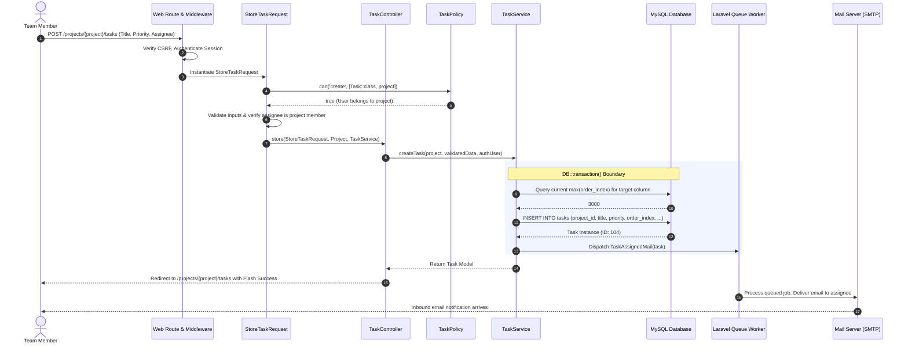
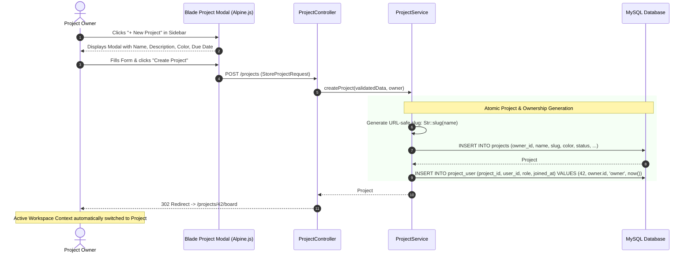
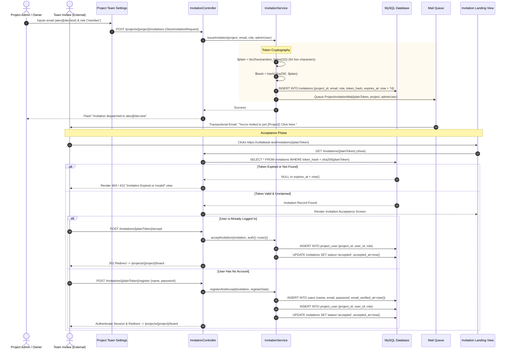
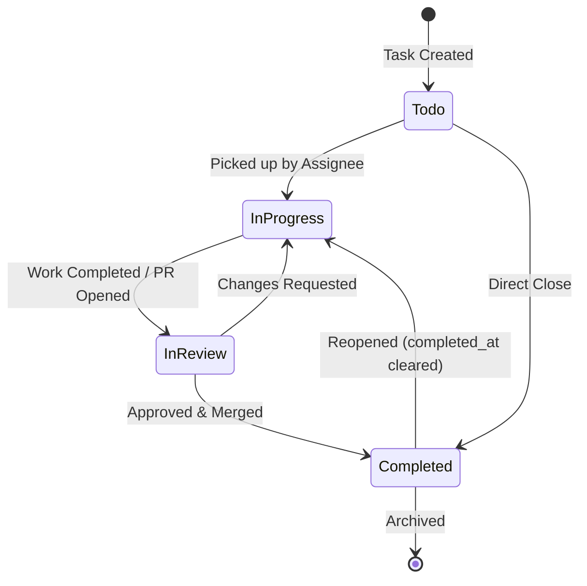
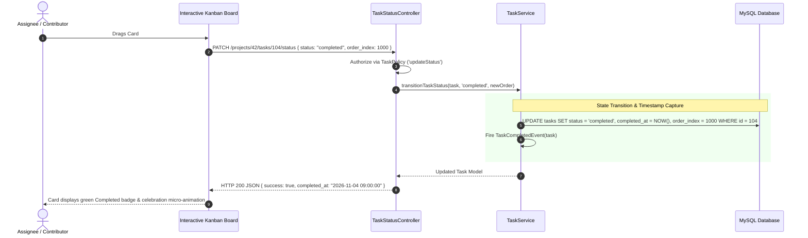

# System & Architectural Data Flow

## Project: CollabTask - Multi-Project & Team Task Management System
- **Document Version:** 1.0.0
- **Scope:** Runtime lifecycle, end-to-end data orchestration, and user interaction sequence models
- **Target Audience:** Full-Stack Engineers, System Architects, API Integrators

---

## 1. Architectural Data Flow: The Request Lifecycle

Every state-altering HTTP transaction in CollabTask traverses a deterministic five-tier pipeline:

```
[ Browser Client ]
        │  1. HTTP POST/PUT/PATCH (Form submission or Fetch API call)
        ▼
[ Routing & Global Middleware ]
        │  2. CSRF Token verification (`VerifyCsrfToken`)
        │  3. User Session Authentication (`auth`)
        │  4. Email Verification Check (`verified`)
        ▼
[ Form Request Layer ]
        │  5. Context Authorization: `authorize()` evaluates Model Policies / Gates
        │  6. Input Validation: `rules()` sanitizes & enforces integrity (enums, dates, DB lookups)
        ▼
[ Thin Controller ]
        │  7. Accepts typed `FormRequest` with guaranteed sanitized payload (`$request->validated()`)
        │  8. Injects Domain Service via Dependency Injection container
        │  9. Delegates work: `$taskService->createTask($project, $payload, auth()->user())`
        ▼
[ Domain Service Layer ]
        │ 10. Opens Database Transaction: `DB::transaction()`
        │ 11. Executes atomic multi-model Eloquent operations
        │ 12. Dispatches asynchronous domain Events / Queued Mailables (`Mail::queue()`)
        │ 13. Commits Database Transaction
        ▼
[ Presentation & Response ]
        │ 14. Controller returns `RedirectResponse` with status flash or Blade View
        ▼
[ Browser Client ]
        │ 15. DOM update via Blade or Alpine.js with visual flash confirmation
```

---

## 2. Sequence Diagram: Architectural Pipeline Walkthrough

The following sequence diagram details an authenticated user submitting a task creation request:



---

## 3. User Interaction Flow 1: Project Creation & Initial Setup

This flow outlines how a project owner initiates a new project container, establishes ownership, and redirects to their new workspace.



### Edge Cases & Exception Handling:
- **Duplicate Slug:** If the owner already owns a project with the same name, the slug generator appends a random increment (e.g., `mobile-app-1`).
- **Validation Failure:** If required fields are omitted, the form re-renders with standard Laravel validation error bags (`$errors->get('name')`) and inputs preserved (`old('name')`).

---

## 4. User Interaction Flow 2: Team Member Invitation & Cryptographic Acceptance

This flow illustrates how new collaborators are securely onboarded without pre-generating accounts.



---

## 5. User Interaction Flow 3: Task Lifecycle & Status Transition

Tasks progress deterministically through their states, triggering notifications, updating sorting order, and capturing completion timestamps.

### 5.1 State Machine Diagram



### 5.2 Sequence Diagram: Drag-and-Drop / Inline Status Transition



---

## 6. Security Scoping & Cross-Tenant Boundary Verification

To guarantee complete multi-project isolation, every request is checked against the following decision tree:

```
                      Inbound Request to /projects/{project}/tasks/{task}
                                              │
                                              ▼
                             Is the User Authenticated?
                                   /             \
                             No   /               \  Yes
                                 ▼                 ▼
                       Redirect to /login    Does User belong to {project}
                                             (via project_user pivot)?
                                                   /             \
                                             No   /               \  Yes
                                                 ▼                 ▼
                                           HTTP 403 Forbidden    Does {task} belong to {project}
                                                                 (project_id matches)?
                                                                       /             \
                                                                 No   /               \  Yes
                                                                     ▼                 ▼
                                                               HTTP 404 Not Found    Does User have permission
                                                                                     for this action (Policy)?
                                                                                           /             \
                                                                                     No   /               \  Yes
                                                                                         ▼                 ▼
                                                                                   HTTP 403 Forbidden    Execute Request
```

This strict architectural boundary guarantees that even if a malicious user alters an ID parameter in the URL or payload, horizontal data leakage across project boundaries is mathematically impossible.

